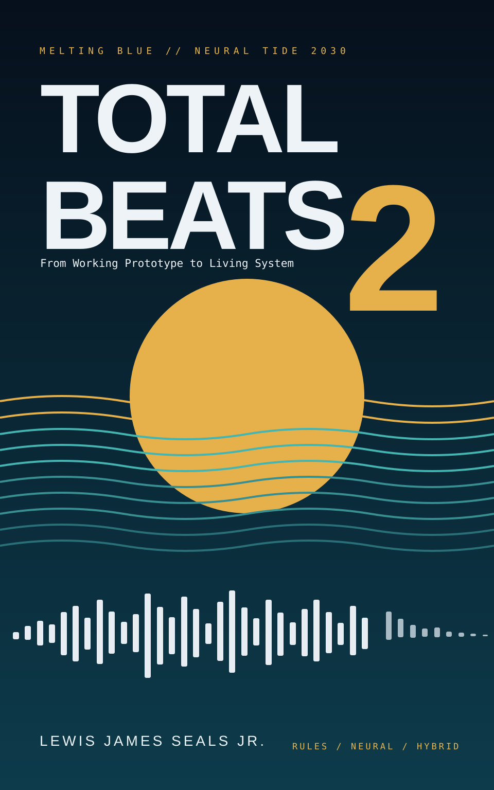

# TOTAL BEATS 2

  

**From Working Prototype to Living System**

*Melting Blue // Neural Tide 2030 — Expanded Edition*

**Author:** Lewis James Seals Jr.  
**Publisher:** Lewis Seals Publishing L3C  
**Manuscript version:** 2.0  
**Edition:** Expanded edition; second edition of the TOTAL BEATS project  
**Length:** 142 pages

## About the book

*TOTAL BEATS 2* presents the project as a transition from a working prototype to a living system. The expanded edition is framed around **Rules / Neural / Hybrid**.

## Book

The complete 142-page PDF edition will be published in this repository as:

`TOTAL_BEATS_2_Lewis_James_Seals_Jr.pdf`

## License and attribution

The book's front matter states that the project is released under the **MIT License**, with the copyright notice preserved.

Copyright © 2026 Lewis Seals Publishing L3C. Written by Lewis James Seals Jr.

The MIT license applies to the project as stated in the book. The copyright notice and attribution must remain with redistributed copies.

---

*Cover artwork in this repository is a vector reconstruction for the README presentation; it is not the original uploaded PNG.*
